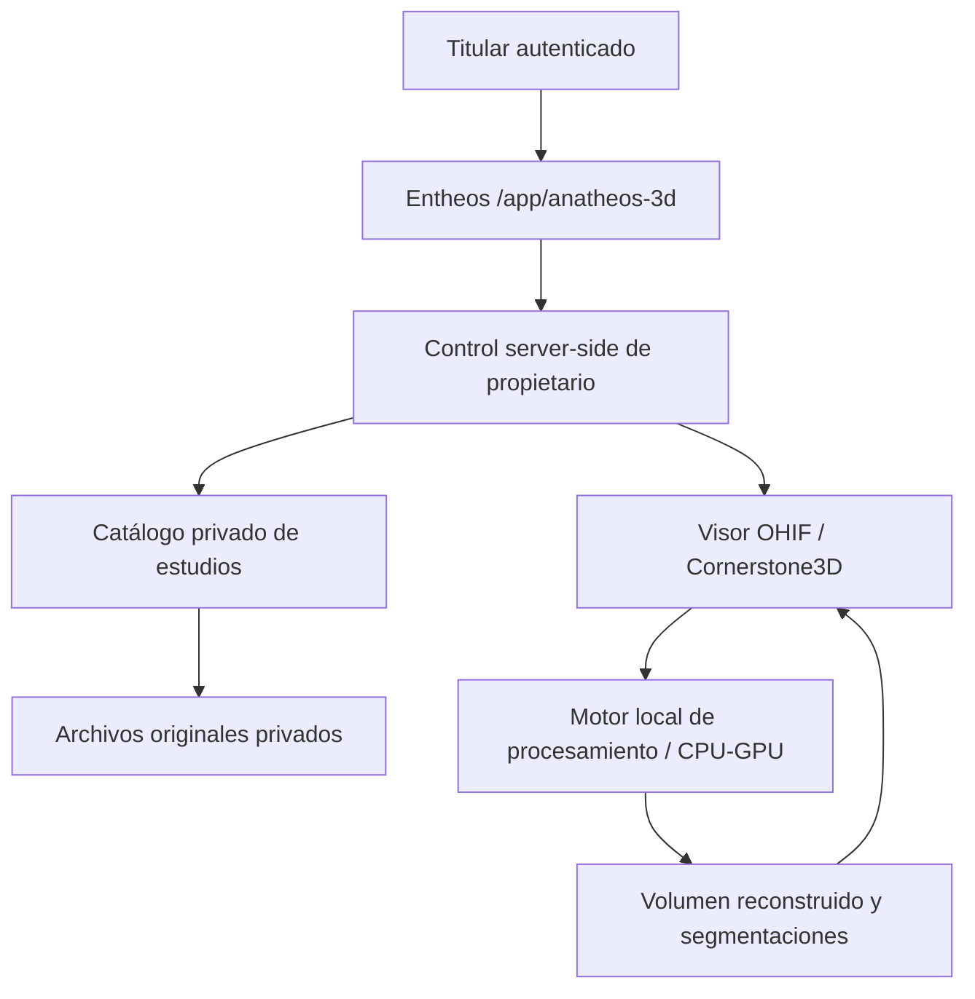

# ANATHEOS 3D — Piloto privado dentro de Entheos

**Estado:** especificación y puerta privada inicial en rama aislada. Sin publicación ni procesamiento de datos reales.
**Fecha:** 2026-10-26
**Repositorio base:** `sinergiaestudio/entheos`
**Rama:** `feature/anatheos-3d-owner-pilot`
**Propietario del piloto:** titular autenticado de Entheos.

## Condiciones aprobadas

1. No contratar servicios SaaS, licencias comerciales, APIs de pago ni suscripciones externas.
2. Todas las capacidades básicas deberán funcionar usando software libre y computación propia. Las necesidades futuras de infraestructura se informarán por separado, sin activar gastos.
3. Conservar `main`, el sitio productivo, sus datos D1 y archivos R2 intactos. No publicar ni fusionar automáticamente.
4. No incorporar expedientes médicos, estudios DICOM ni claves reales al repositorio GitHub **público**. Los ejemplos de desarrollo deben ser sintéticos o conjuntos de datos públicos anonimizados.
5. El piloto estará disponible para **un solo titular autorizado**. Git no controla el acceso a la aplicación: la autorización deberá verificarse en servidor para cada ruta y cada operación.
6. La rama queda abierta para iteración y pruebas; la apertura a terceros requiere aprobación expresa futura.

## Adaptación a la arquitectura actual

Entheos utiliza Next/Vinext + React sobre Cloudflare Workers, identidad ChatGPT/Sites, D1 y R2. Mantendremos esa arquitectura para su portal. Los trabajos intensivos de reconstrucción no se ejecutarán directamente en un Worker de Cloudflare.

### Plan por etapas

- **P0 — Aislamiento de rama y puerta privada.** Ruta `/app/anatheos-3d`, sólo acceso con `isGlobalAdmin`, sin navegación pública, sin almacenamiento real y sin nuevas dependencias. Validar que el entorno propietario dispone de `APP_OWNER_EMAIL`.
- **P1 — Reconstrucción local sin IA.** Importación de series DICOM completas, verificación de geometría, MPR axial/coronal/sagital, renderizado volumétrico. Preferir procesamiento en el navegador si el tamaño lo permite. Conservar originales inmutables.
- **P2 — Motor local.** SimpleITK/pydicom en servicio local independiente, con conexión autenticada; estudio de si DICOMweb/Orthanc agrega valor a la escala real. Nunca exponer Orthanc o servicios médicos directamente a Internet.
- **P3 — Segmentación opcional.** Modelos libres y ponderaciones con permisos adecuados; empezar por `total` y `total_mr` de TotalSegmentator. No habilitar subtareas cuya licencia demande pago o revisión comercial sin aceptación.
- **P4 — Colaboración.** Consentimiento, modelo de profesionales, controles de ámbito, auditoría, validación clínica y revisión regulatoria antes de habilitar terceros.

## Aceptación de P1

- Aceptar solamente series volumétricas compatibles. Rechazar errores geométricos y estudios incompletos de manera explícita.
- Respetar orientación, espaciamiento y posiciones DICOM; comparar con 3D Slicer.
- Visualización 3D y sincronización de tres planos ortogonales.
- Indicar limitaciones de la interpolación, grosor de corte y secuencias RM.
- No automatizar diagnósticos ni inferir patologías.

## Privacidad y permisos

- `main` y despliegue de Entheos permanecen sin cambios.
- Toda ruta experimental debe fallar cerrada sin autenticación válida o si el usuario no coincide con `APP_OWNER_EMAIL` (control de servidor).
- `robots=noindex,nofollow`, `Cache-Control: no-store` en operaciones clínicas, sin logs de PHI.
- La rama Git es **pública** porque el repositorio es público: jamás registrar datos reales, secretos, rutas internas sensibles ni archivos derivados reales en commits.
- Antes de cualquier entorno de pruebas online, usar datos públicos anonimizados y verificar que la rama no comparta permisos o almacenamiento clínico de producción de forma inadvertida.
- Al publicar el piloto posteriormente, exigir un entorno aislado y constatar su URL y restricciones de acceso antes de comunicarlo como habilitado.

## Licencias previstas

- OHIF / Cornerstone3D: MIT.
- 3D Slicer: estilo BSD.
- SimpleITK: Apache-2.0.
- Orthanc: GPLv3+; plugin DICOMweb: AGPL, sujeto a revisión del modo de distribución e interacción en red.
- TotalSegmentator: repositorio Apache-2.0; ciertas tareas/modelos tienen términos adicionales. Usar sólo los permitidos sin pago y llevar inventario de versiones/modelos.
- Revisar condiciones de cada dependencia y atribuciones antes de distribución a terceros.

## Restricciones operativas

No hay promesa de coste total cero para hardware, electricidad, dominio o alojamiento. La exigencia expresa es **ningún pago adicional ni alta de proveedores externos sin aprobación**. No se configurarán integraciones con servicios externos de procesamiento médico.

## Estado verificable

- Rama creada en GitHub; no fusionada a `main`.
- Ruta piloto de acceso exclusivo al propietario, en el código de la rama, sin despliegue verificado.
- Ningún estudio médico cargado ni procesado por la nueva funcionalidad.
